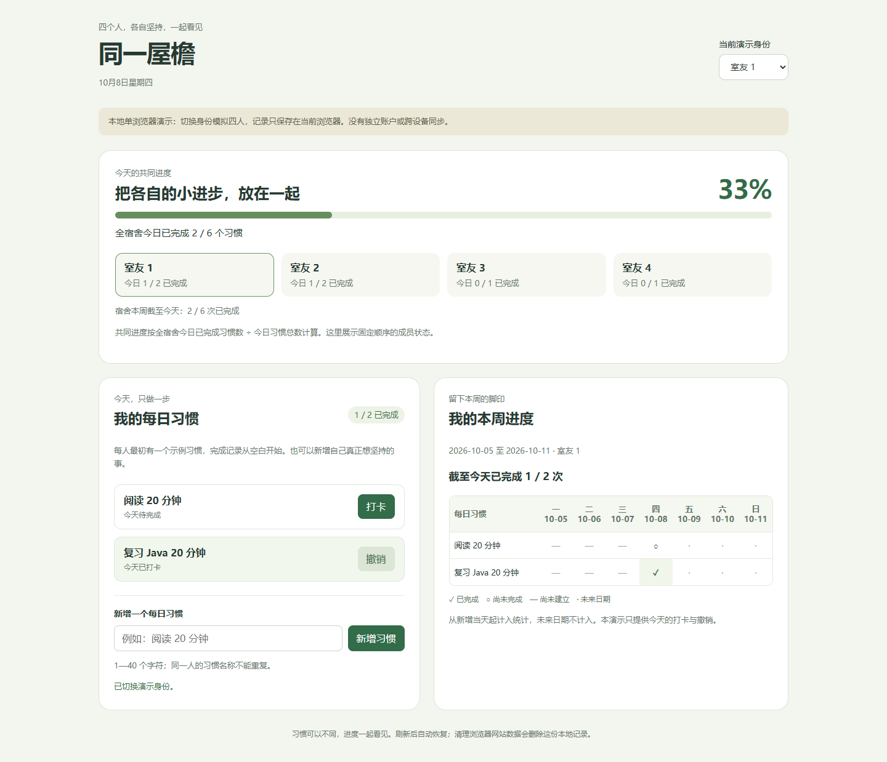

# Co-Decide 共创

**在重要分岔前看见不同结果，让你的选择真正参与成品。**

Co-Decide 是一个轻量的协作 Skill，当前版本 **0.5.0**。你只需给出目标，agent 自行发现值得共同决定的取舍，查找依据、准备可比较的小样，再逐题与你合作完成任务。

适用于开放式产品设计、项目构建、写作、活动策划、资料整理和研究方案。明确的修改与修复直接执行；常规技术实现、衔接和质量验证由 agent 负责。

## 一分钟看懂

```text
用 $co-decide 帮我们四人宿舍做一个能实际使用的习惯打卡程序。
```

下面是一段协作流程示意；真正使用时，选项必须对应已经展示的具体小样：

| 环节 | 你会看到什么 |
| --- | --- |
| 发现分岔 | 各自坚持不同习惯，还是共同完成同一挑战？ |
| 比较小样 | 同一宿舍场景下，两种机制的界面与打卡过程 |
| 一次一题 | 推荐 A：个人习惯互相鼓励，各自目标更自由；B：共同挑战，更容易围绕同一目标行动 |
| 自由组合 | “用 A 的个人习惯，加 B 的共同进度，不要排名。” |
| 整合交付 | 检查组合后的统计含义和依赖，完成关键流程并验证 |

选择可以混合，也可以否定现有候选或说“这项你决定”。后续反馈会更新对应决定，并保留其他有效选择。

以下是一次模型测试中，收到**模拟用户选择**后完成的本地演示。它支持新增、打卡、撤销、本周进度和刷新保存；四人身份由同一浏览器模拟。



[运行示例](examples/dorm-habits/README.md) · [验证证据与限制](docs/verification.md)

## 在 Codex 中安装

需要支持 `codex plugin` 命令的 Codex 版本。本项目使用 Codex CLI **0.160.1** 核验安装命令与本地插件加载；其他版本请先检查 `codex plugin --help`。

```sh
codex plugin marketplace add chaosmakerw/co-decide --ref main
codex plugin add co-decide@co-decide
```

在启用插件的**新聊天**中调用：

```text
用 $co-decide 与我合作完成这个任务。
```

也可只输入任务，让模型自行选择 Skill。明确调用是更容易确认加载的入口；自然触发仍取决于模型和宿主，不能保证每次发生。

检查安装：

```sh
codex plugin list --marketplace co-decide --json
```

本地开发安装：

```sh
git clone https://github.com/chaosmakerw/co-decide.git
cd co-decide
codex plugin marketplace add .
codex plugin add co-decide@co-decide
```

命令与 marketplace 布局依据 [OpenAI 插件打包文档](https://developers.openai.com/plugins/build/plugins)。若客户端未提供上述命令，先核对版本与官方文档。

### 只在一个项目启用

安装命令可能开启用户级开关。将 Codex 用户配置中的这一项设为：

```toml
# ~/.codex/config.toml（Windows 为 %USERPROFILE%\.codex\config.toml）
[plugins."co-decide@co-decide"]
enabled = false
```

再在目标项目的 `.codex/config.toml` 中设置：

```toml
[plugins."co-decide@co-decide"]
enabled = true
```

合并到已有配置，避免重复同名表；项目需要处于可信状态。打开目标项目的新聊天进行验证。项目开关的加载行为由宿主控制。

## 怎样共同决定

agent 仅在三项条件同时成立时提问：有合理而实质不同的未决方向；答案明显影响成果、体验或返工；现有偏好、资料、查证与委托仍不能决定。

小样随任务变化：网页可以对比实际内容、风格或交互；写作可以对比同段原文的编辑方式；研究可以对比证据路线。需要外部依据时主动搜索并打开来源，区分事实、假设和演示内容。

**每次只有一道待答题。** 推荐、选项及结果差异保留在聊天正文中。提问后暂停整个任务，包括验证和子 agent；收到明确选择、可落实的自由反馈或当前决定的委托才继续。空答、默认勾选、超时和卡片消失均不算选择。

首次工具超时或空答后，再等待 **90 分钟**；到期仍无回复，继续保留问题并暂停。宿主中断时在普通聊天中保留待答题。这是 Skill 的等待规则，**无法延长原生卡片显示时长，也不能保证宿主连续运行 90 分钟**。

## 调整发散程度

在任务中说“发散：低／中／高”，或“多探索一些”“收敛一点”。默认中，无需先回答设置题。

| 档位 | 探索方式 | 当前一题的候选上限 |
| --- | --- | --- |
| 低 | 成熟、容易落实的路径 | 2 个 |
| 中（默认） | 不同的主要机制，通常展示两份小样 | 3 个 |
| 高 | 扩大机制与领域跨度，探索有依据的其他解法 | 4 个 |

上限不要求凑数。你也可以说“只这一题发散调高”；之后恢复任务档位。等待时调档只重做当前候选，不代替选择，也不重置同题截止时间。

这控制探索策略与方案筛选，**不修改模型推理档位、温度或原生界面**；设置仅保留在当前任务上下文。

## 轻量结构与能力边界

运行核心只有一个 [SKILL.md](skills/co-decide/SKILL.md)，约 9 KB。插件没有独立后端、MCP 服务或常驻进程。它沿用宿主工具、权限和用户已有约定，准备样板或选择方案不会扩大修改授权。

行为指令仍需要模型执行。当前证据包含结构检查、独立模型场景和本地浏览器演示；没有证明跨宿主兼容、普遍稳定触发、实际 token 节省比例，或成品必然优于传统多轮修改。详见 [验证说明](docs/verification.md)。

## 开发与贡献

Python **3.10+**，打包工具只使用标准库：

```sh
python tools/package_plugin.py
```

输出 `dist/co-decide-0.5.0.zip`，检查 manifest、marketplace、路径、图标及归档内容。ZIP 按白名单包含七个文件（含许可证），开发材料与示例不进入运行包。README 中的示例和证据链接指向仓库；ZIP 用于传递单插件文件，Codex 安装入口仍是上述 marketplace。

- [场景集](checks/scenarios.md)：复现和评估协作行为。
- [贡献指南](CONTRIBUTING.md)：如何报告问题与验证改动。
- [README 参考](docs/readme-references.md)：借鉴 Superpowers、Anthropic Skills、Matt Pocock Skills 的说明结构。

采用 [MIT License](LICENSE)。
