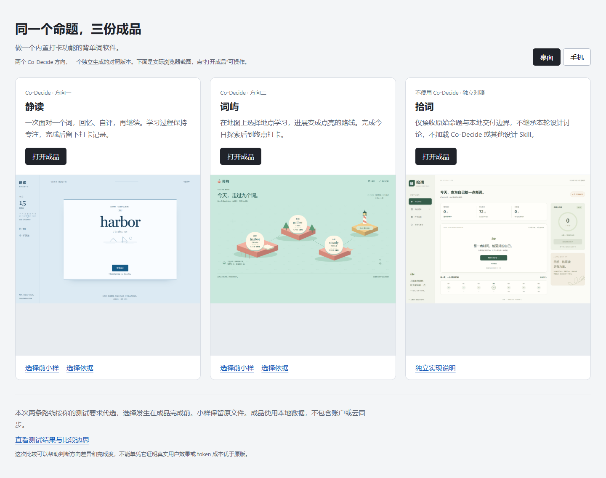

# Co-Decide 共创

**先看见不同的产品路线，再让你的选择贯穿成品。**

Co-Decide 是一个轻量的协作 Skill，重点帮助用户与 agent 共同决定**产品与界面设计**、**软件业务设计**中容易被默认决定的重要取舍。你给出目标，agent 发现尚未确定的方向、展示可比较的小样；你选择、组合或提出新方向，agent 负责实现、衔接与质量验证。

发布元数据沿用 **0.6.0**。当前源码补齐“制作前构思 → 可操作小样 → 选择 → 成品”的流程，并内置按需读取的 Frontend Design、布局主题、动作与收尾参考。先明确使用目标、内容主次、构图与素材，再用实际画面和连续操作比较方向。最新 [背单词三份成品对照](examples/vocabulary-2026-10-15/index.html) 包含两个插件路线与一个未加载 Skill 的独立对照；选择时小样和验证边界一并保留。此前 [骨架探索](docs/skeleton-2026-10-12.md)、[视觉发散](docs/visual-divergence-2026-10-12.md) 保留各自版本依据。仓库更新不会自动刷新本机插件缓存。

## 先看小样



克隆或下载仓库后，双击 [最新比较入口](examples/vocabulary-2026-10-15/index.html)：**静读**用阅读纸与逐词回忆，完成后自动打卡；**词屿**以地图推进学习，到灯塔主动打卡；**拾词**是独立生成的学习仪表盘。三份均可本地直接使用，无需运行时依赖。对照是执行者按用户要求代选，不能当作真人满意度或 token 优势证明。详见 [本轮报告](examples/vocabulary-2026-10-15/report.md) 与 [选择依据](examples/vocabulary-2026-10-15/choice.md)。

克隆或下载仓库后，还可双击此前 [共享工坊对比页](examples/skeleton-2026-10-12/compare.html)，体验围绕设备、人的当天安排、现场待办组织的三种产品骨架。各路线都能走过损坏归还、预约受影响、停止借出、维修恢复和继续交接。此前 [电影收藏](examples/visual-divergence-2026-10-12/README.md) 及 [旅行与乐队](examples/imagination-2026-10-11/README.md) 也保留，无需安装依赖。

共享工坊等此前案例是用户选择方向之前的小样，刷新还原演示状态；不作为完整成品、真人满意度或成本优势的证明。此前原版与插件的 [六份成品对照](examples/rebuild-2026-10-11/README.md) 也保留在仓库中。

## 主要解决什么问题

| 重点 | 值得共同决定的内容 | 怎样看见差异 |
| --- | --- | --- |
| 产品与界面设计 | 内容主次、信息结构、整体构图、视觉语言和主要操作路径 | 用同一份输入预览整体结构，并走过一条主要操作 |
| 软件业务设计 | 参与者、状态何时生效、权限、责任及重要异常的处理 | 用同一个动作查看各方的状态、下一步和实际后果 |

共同选择须有实质影响、合理取舍，且现有偏好或委托仍不足以决定。模型根据任务发现这些分岔，用户无需预先列出沟通点。已明确的规格、常规修复和技术实现直接执行。

## 怎样使用

在启用插件的新聊天中，给出自然目标即可：

```text
用 $co-decide 做一个我自己用的阅读管理工具。
```

```text
用 $co-decide 做一个三人小团队的请假管理工具。
```

这两项也是此前成品对照的测试任务：每项比较原版一个成品与插件两种选择结果。结果、成本和验证边界以 [重建报告](docs/rebuild-2026-10-11.md) 为准，测试设计不代表已证明优势。工坊、电影收藏、旅行与乐队案例只观察候选阶段；最新背词案例的独立对照及成本限制见其单独报告。

## 协作流程

1. **先构思再制作。** 用几行说明使用目标、内容主次、骨架、具体构图与素材及动作反馈，落实成可见小样。 查明共同业务约束，比较用户从哪里进入、围绕什么信息工作、如何跨页面完成任务。参考不足时研究同类与跨领域范例，再发展各路线的视觉语言。整体审美与氛围也值得共同选择。
2. **比较同一输入。** 界面小样让结构、观感和操作方式可见；业务对照让状态、责任和异常后果可见。推荐附依据，选项说清结果与代价。
3. **一次只问一题。** 你可以选一条路线、自由混合、否定候选，或说“这项你决定”。收到可落实的反馈后才继续。
4. **把选择写进验收。** 用一句话或至多三条可观察条件概括反馈，直接落实。交付时检查原场景和一个有依据的不同输入，核对成品兑现了什么。

例如，你可以说：“保留 A 的内容组织，使用 B 的主要操作；这项业务按 A 的方式生效。”agent 负责检查组合后的整体一致性，不把衔接工作变成新的问卷。

开放的整产品默认探索3条路线，高发散4条，用户指定数量优先。每条路线建立自己的构图、字体层次、图形或影像和空间节奏，功能取舍再结合为连贯产品；视觉风格不固定绑定某套功能，允许自由组合。参考帮助扩展设计，不增加未经选择的功能清单。

先用简短导航图说明组织方式，再用相同内容、相同视口比较代表页面与连续操作。去掉装饰后，入口、信息组织或主流程仍应不同；遮住名称后，整体视觉仍应可辨认。差异延续到关联页面及相关角色，不能只改首页。各路线完成同一核心任务的可判断闭环，辅助功能须说明价值与操作负担；过薄补必要步骤，过重收起低价值步骤。可用专业前端设计 Skill 辅助，不设强制依赖或改变安装状态。

小样共用资料与底层机制；导航、页面关系与工作区按路线组织。审美对照展示真实内容、构图、字体和视觉语言，纯线框不足以代替。差异足够判断就提问，完整可靠性与边界检查留到选择后，不为每个候选复制完整软件。原小样保留稳定入口供回看；落选路线单独保留，成品沿有效选择展开。

通常完善用户选定的一份成品；用户明确要求多份成品对照时，先确定整组方向，再分别完成。候选看起来接近成品，不等于已经完成正式交付，也不把选择过程推迟到成品完成之后。

### 等待与发散

推荐、全部选项和小样入口保留在正文中，原生卡片作为辅助。提问后整个任务及子 agent 暂停；明确选择、可落实方向或本题委托才允许继续。工具的 `accepted` 回执只是送出成功，空答、超时或卡片消失都不是反馈。

首次超时或空答后再等待 **90 分钟**；到期仍无回复，保留原题并暂停。这是 Skill 的执行规则，无法延长原生卡片显示时长，也不能保证宿主持续运行 90 分钟。宿主中断时用普通聊天保留待答题。

用户明确委托代选或自主完成时，在授权范围内继续并标记选择依据；包含模拟选择的评测亦需明确授权。普通“自动测试”不构成替用户选择的许可。

可以说“发散：低／中／高”，默认中；开放的整产品目标3条，低最多2条，高4条，指定数量优先。已有决定或真实约束限制设计自由度时说明依据，保留有价值的选择。调档扩大路线差异，不增加题数；仅在当前任务生效，不修改模型参数或原生界面。

## 在 Codex 中安装

以下是此前使用 Codex CLI **0.160.1** 核验的方法，**本轮未重新核验安装流程**。需要支持 `codex plugin` 命令的版本；其他版本先检查 `codex plugin --help`。本次上传发布源码与本地示例，不运行插件安装器，不修改宿主配置或安装状态。

```sh
codex plugin marketplace add chaosmakerw/co-decide --ref main
codex plugin add co-decide@co-decide
```

检查安装：

```sh
codex plugin list --marketplace co-decide --json
```

本地开发安装：

```sh
git clone https://github.com/chaosmakerw/co-decide.git
cd co-decide
codex plugin marketplace add .
codex plugin add co-decide@co-decide
```

命令与布局参考 [OpenAI 插件打包文档](https://developers.openai.com/plugins/build/plugins)。项目启用范围沿用宿主已有设置，本轮重建不改变用户或项目配置、安装缓存及插件状态。

明确调用 `$co-decide` 更容易核对 Skill 是否加载；只输入任务时，自然触发仍取决于模型和宿主。

## 成本、质量与边界

目标是在接近原版的成本下，得到更适合用户的产品及更有意义的选择。入口精简、复用小样和集中验收是实现手段，**并不等于已证明节省 token 或优于原版**。评估应检查实际产品差异、选择兑现和完整任务成本，包含共同探索、失败尝试与子 agent。

核心只有一个 [SKILL.md](skills/co-decide/SKILL.md)，没有独立后端、MCP 服务或常驻进程。行为依赖模型执行，沿用宿主工具、权限和用户约定；小样与选择不会扩大编辑、发布、删除或付费授权。

- [六条候选路线](examples/imagination-2026-10-11/README.md) · [补测记录](docs/imagination-2026-10-11.md)：旅行与乐队的可操作小样、真实截图及验证范围。
- [三种工坊骨架](examples/skeleton-2026-10-12/README.md) · [骨架探索记录](docs/skeleton-2026-10-12.md)：多角色、关联记录与连续异常流程；首轮视觉缺项及修订均保留。
- [六份成品与原小样](examples/rebuild-2026-10-11/README.md)：此前原版与插件的成品截图对照，双击 `start.cmd` 可分别体验。
- [多元探索记录](docs/diversity-2026-10-11.md)：外部范例、探索方向与首次决策阶段的定向验证。
- [本轮重建报告](docs/rebuild-2026-10-11.md)：两类任务、多种选择结果及成本比较。请假登记路线观察到成本优势；界面路线尚未证明稳定省 token，不宣称普遍胜出。
- [此前成对比较](docs/paired-evaluation-2026-10-11.md) · [此前精简候选测试](docs/optimization-2026-10-11.md)：保留原始结论与限制。
- [历史验证说明](docs/verification.md) · [宿舍打卡示例](examples/dorm-habits/README.md)：先前版本的结构检查与本地演示，不能代替本轮验证。

## 开发与贡献

Python **3.10+**，打包工具只使用标准库：

```sh
python tools/package_plugin.py
```

按当前元数据输出 `dist/co-decide-0.6.0.zip`，检查 manifest、marketplace、路径、图标及归档内容。ZIP 按白名单包含20个文件，涵盖核心、按需参考及其许可证；示例及测试材料不进入运行包；发布状态仍以仓库记录为准。

[场景集](checks/scenarios.md) · [贡献指南](CONTRIBUTING.md) · [README 参考](docs/readme-references.md)

Co-Decide 自有内容采用 [MIT License](LICENSE)。内置第三方参考分别沿用 Apache-2.0 或 MIT，完整固定来源、许可和通知见 [Frontend Design 来源](skills/co-decide/references/frontend-design/SOURCE.md) 与 [细节指导来源](skills/co-decide/references/interface-craft/SOURCE.md)；未捆绑 GSAP 运行库。
