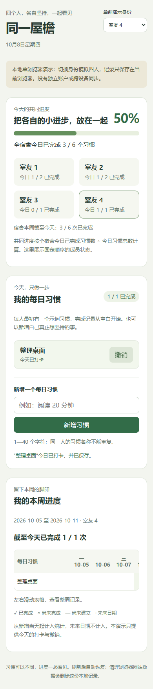

# 宿舍习惯打卡：本地演示

这是 Co-Decide 0.5.0 一次模型场景测试的产物。实现依据是明确标注的**模拟用户反馈**：个人习惯 + 宿舍共同进度，每人可以有不同习惯，无排名、无惩罚；先做本地单浏览器演示。

## 运行

需要 Node.js，运行应用无需安装 npm 依赖：

```sh
cd examples/dorm-habits
node server.cjs
```

打开 <http://127.0.0.1:4173/>，按 Ctrl+C 停止服务。

1. 选择室友 1—4，模拟切换使用者。
2. 新增个人每日习惯，点击“打卡”或“撤销”。
3. 查看个人本周记录和宿舍共同进度。
4. 刷新页面，习惯、记录和当前演示身份保留。

## 范围与统计规则

- 共同进度 = 全宿舍今日已完成习惯数 / 今日习惯总数。新增习惯当天计入总数，四人习惯数量可以不同。
- 本周从星期一开始，习惯新增前与未来日期不计入应完成次数。日期使用电脑本地时区，只支持当天打卡或撤销。
- 数据存储在当前浏览器、当前来源的 localStorage。请保持相同地址和端口；清理网站数据或换浏览器不会保留这份记录。
- 身份切换是演示机制，没有认证、服务器权限、跨设备同步或备份，尚不能供真实四人独立登录并共享数据。
- 网页没有 CDN、数据库或真实模型调用；Node.js 只提供本机静态文件。

## 复现浏览器验证

测试使用 `playwright-core` 和本机 Microsoft Edge，自动创建隔离测试会话、随机本地端口，并在结束后关闭浏览器和服务。测试数据为合成夹具。

```sh
npm ci --ignore-scripts
npm run check
npm test
```

浏览器测试脚本当前面向 Windows + 已安装 Edge；其他环境需调整浏览器路径。新报告与截图输出到 `artifacts/`。已有截图和 [历史脱敏报告](../../docs/evidence/dorm-browser-0.5.0.json) 对应 2026-10-08 的实际 12 场景验证，不代表所有多人环境均已验收。


