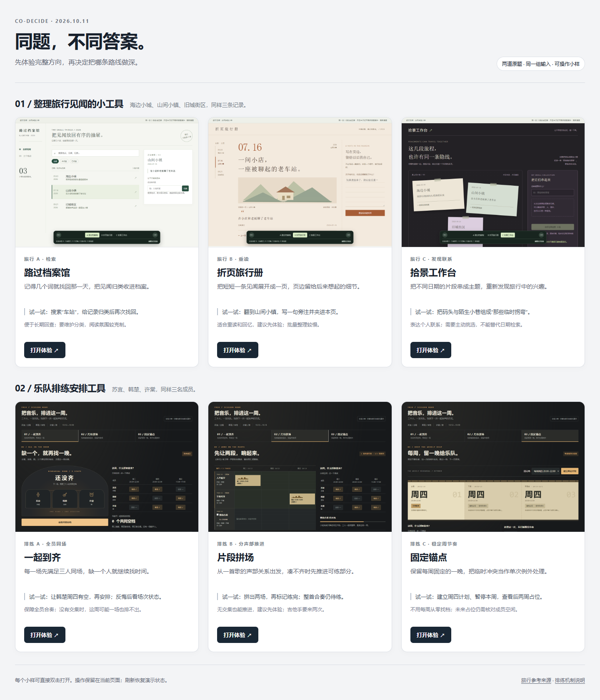

# 同题，不同答案

两道自然任务各展示三条可操作路线：

> 帮我做一个整理旅行见闻的小工具。
>
> 给乐队做一个排练安排工具。

克隆或下载仓库后，双击 [index.html](index.html)，再点击“打开体验”。无需 Node.js、npm、服务或安装。GitHub 文件页展示源码；要操作请在本地浏览器打开文件。

| 题目 | 路线 | 亲手体验的差异 |
| --- | --- | --- |
| 旅行 | A 路过档案馆 | 搜索“车站”，归类后按归类名找回同一段原文 |
| 旅行 | B 折页旅行册 | 翻页重读，夹入后来补写，保留原文 |
| 旅行 | C 拾景工作台 | 将不同日期的见闻组成自己命名的线索束 |
| 乐队 | A 一起到齐 | 没有全员空档不成立；成员临时没空后进入待重排 |
| 乐队 | B 片段拼场 | 无全员空档也能排两个小组；两段练完不等于整首已练 |
| 乐队 | C 固定锚点 | 暂停本周或单次改期，保留未来固定计划；未来占位仍待核对 |

旅行小样使用同样三条 [见闻](travel/notes.csv)，底部切换器和左右方向键可切换 A/B/C；输入时方向键保留编辑用途，切换路线保留当前内存操作。乐队小样使用同样三名 [成员](band/members.csv)，页面顶部切换安排方式；路线链接重新打开演示初始状态。

全部资料为合成数据。乐队空闲、曲目与日期是额外的演示场景，未收集真实成员回复；旅行装饰为原创 SVG，不是真实地点照片。操作只保留在当前页面，刷新还原。没有账号、云同步、真实通知、场地预订或部署。

## 来源与验证

旅行探索实际阅读了同类与跨领域页面，见 [参考来源](travel/sources.md)；乐队保留原测试人为设定的离线条件，没有声称实际断网。推荐、代价和精确操作见 [旅行说明](travel/review.md) 与 [排练说明](band/review.md)。

六张小样图片与对比页图片均来自实际 Edge 运行。旅行截图显示初始页面或组线索后的状态；乐队截图分别展示无共同空档、两段已练、仅本周暂停的演示结果。图片不是每次打开的初始状态。

[来源与逐文件 SHA-256](source/provenance.json) 核对15个复制文件与本地实测版本一致。原始小样和依赖一并保留，没有把落选路线混入某个最终产品。当前尚未收到方向选择，未制作选定后的成品；没有本轮原版对照或完整 token 计量。

[补测记录](../../docs/imagination-2026-10-11.md) · [插件说明](../../README.md)
