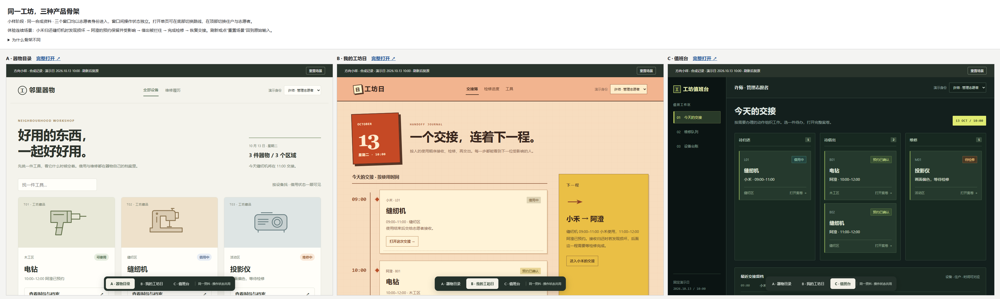

# 共享工坊：三种产品骨架

双击 [compare.html](compare.html) 比较三条可操作小样，或双击 [index.html](index.html)，用底部按钮切换路线。单页换路线保留状态，三个对比窗口各自独立；刷新或“重置场景”恢复同一合成输入。无需安装依赖。

| 路线 | 入口与主任务 | 视觉表达 | 代价 |
| --- | --- | --- | --- |
| A 器物目录 | 设备目录 → 器物档案 → 时段、借还与维修履历 | 暖纸目录、工具图形、宽松栏目 | 多设备交接要逐件进入 |
| B 我的工坊日 | 当天安排／交接簿 → 一程的步骤 → 检修与下一位 | 手作纸样、橙红日期章、印刷交接票 | 浏览全部设备要进入找工具 |
| C 值班台 | 待归还／待借出／维修队列 → 关联案卷 → 办理 | 深色维修设备台、荧黄动作、方形轨道 | 住户入口更像现场工作台 |

体验连续场景：切志愿者许师，进入小禾的缝纫机借用L01，接收归还并选择损坏、填写问题；切阿澄查看自己的B02预约受影响且保留；切回许师尝试借出，查看拦截；完成M02检修，再办理B02借出。具体导航见 [骨架说明](skeleton.md)。

真实Edge检查：七项共享业务场景通过（直接模型调用）；三路线的真实控件连续流程、390px布局与页面异常共六项通过；对比页三框加载同一原始输入的一项核对通过。共用脚本修订前后完全相同。版本与证据边界见 [本轮报告](../../docs/skeleton-2026-10-12.md)。

首轮骨架已有差异，但三版浅绿米白气质趋同，根评测者未接受其视觉发散。原文件保留在 [before](before/index.html)，首轮题目与来源也保留；后续只改B/C视觉，见 [修订记录](visual-revision.md)。隐藏名称及去装饰截图保留在screenshots。

[首次选择题](choice.md) 尚无答案，没有默认采纳推荐或进入正式成品。输入为虚构记录，时间固定为2026-10-13 10:00；状态只在本机内存，角色切换是演示，没有真实认证、后端、数据库或多人同步。

[参考来源](sources.md) · [首轮E1](frozen/SKILL.md) · [反馈后最终E2](frozen/final-SKILL.md) · [副本依据](provenance.json)。公开副本的两份sources.md将运行机器路径替换为可移植引用，其余复制文件按原字节保留；文本另记归一化LF哈希，避免混淆Git换行转换。
