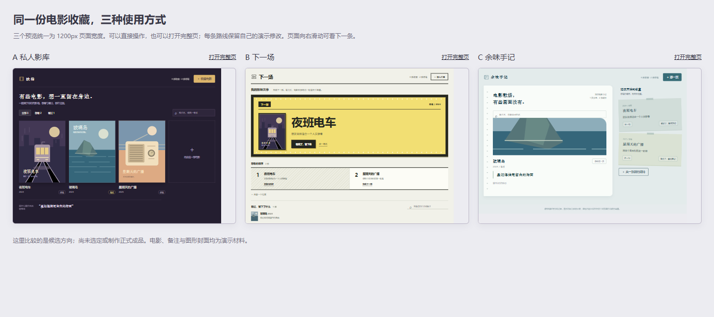

# 电影收藏：先看方向，再选择

本轮自然输入只有“帮我做一个收藏电影的小工具。”和三个虚构电影记录，未预设风格、功能取舍或候选答案。

双击 [compare.html](compare.html) 可并排体验同一1200×900视口的三种方向；[index.html](index.html) 可打开完整页，从顶部切换。无需安装框架或启动服务。

- 私人影库：深色海报墙，先浏览收藏、筛选和打开一部电影。
- 下一场：影院排片灯箱，先关注下一部，再维护观看顺序。
- 余味手记：长页手记与期待便笺，先回看自己的备注，再转换观看状态。

各路线都能新增电影、保留备注、改状态、找回记录，使用相同初始输入和共用处理逻辑。点击“恢复样本”只还原当前路线的演示数据。电影、记录、原创SVG封面均为合成；只有浏览器本地演示存储，没有真实资料检索、账号、跨设备同步、通知或上线。

完整拟提问题见 [choice.md](choice.md)。评测运行已停在首次方向选择，尚未向真人提问或收到答案，没有选定后的正式成品；这些文件是可操作候选，不冒充完整交付。

## 回看首轮

[before/compare.html](before/compare.html) 保留首次独立生成的小样，包含B的原浅色双栏；该小样在视觉评审后、用户选择之前修订，未覆盖原文件。两份入口使用相同演示存储键，回看前可从完整页“恢复样本”。

screenshots/中保留最终首屏、代表操作和隐藏品牌/导航的对照图。首屏为原始三条输入，操作图片含根评测者合成新增电影或状态转换；不是每次启动的状态。参考及迁移方式见 [sources.md](sources.md)。

[来源摘要](source/provenance.json) 区分原始复制字节与统一LF换行的文本哈希，避免跨平台换行导致误判。不含宿主配置、原始会话或用户个人绝对路径。

[规则与验证记录](../../docs/visual-divergence-2026-10-12.md) · [插件说明](../../README.md)
